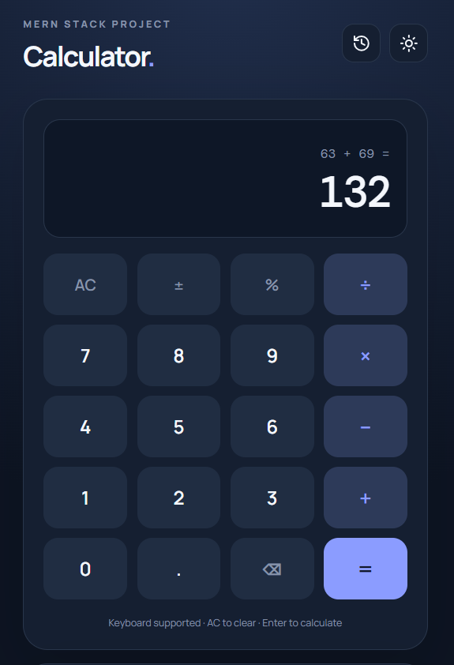
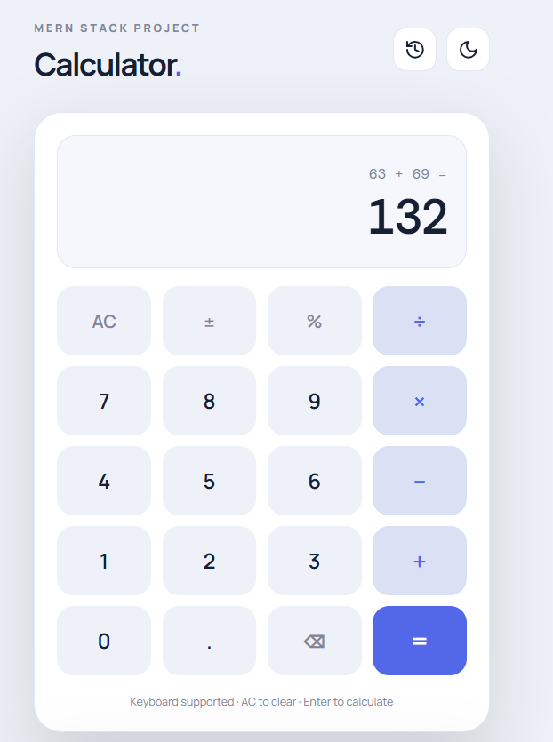
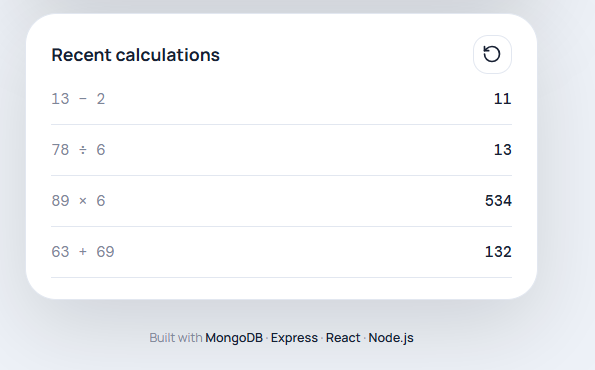

# 🧮 MERN Calculator

<div align="center">


**A modern, responsive calculator application built using the MERN stack.**

</div>

## 📸 Screenshots

<!-- Add your project screenshots in the screenshots folder -->

### Calculator – Dark Mode


### Calculator – Light Mode


### Calculation History


## ✨ Features

- ➕ Basic arithmetic operations (Addition, Subtraction, Multiplication, Division).
- 🔢 Decimal number calculations.
- 📊 Percentage calculations.
- ➖ Positive/Negative number toggle.
- ⌫ Backspace and Clear functionality.
- ⌨️ Keyboard support for calculations.
- 🌙 Light and Dark mode.
- 📜 Calculation history.
- 💾 MongoDB integration for storing calculation history.
- 📱 Fully responsive user interface.
- ⚡ Fast frontend development with Vite.

## 🛠️ Tech Stack

**Frontend**
- React.js
- JavaScript
- CSS3
- Vite
- Lucide React Icons

**Backend**
- Node.js
- Express.js
- REST API

**Database**
- MongoDB
- Mongoose

## 📂 Project Structure

```text
mern-calculator/
│
├── client/
│   ├── src/
│   │   ├── App.jsx
│   │   ├── main.jsx
│   │   └── style.css
│   ├── index.html
│   ├── vite.config.js
│   └── package.json
│
├── server/
│   ├── server.js
│   ├── .env.example
│   └── package.json
│
├── .gitignore
├── package.json
└── README.md
```

## ⚙️ Installation & Setup

### 1. Clone the repository

```bash
git clone https://github.com/your-username/mern-calculator.git
```

### 2. Navigate to the project directory

```bash
cd mern-calculator
```

### 3. Install dependencies

```bash
npm run install:all
```

### 4. Configure environment variables

Create a `.env` file inside the `server` directory using `.env.example`.

```env
PORT=5000
MONGO_URI=mongodb://127.0.0.1:27017/mern_calculator
```

You can also use a MongoDB Atlas connection string.

### 5. Start MongoDB

Make sure your local MongoDB server is running, or configure your MongoDB Atlas database.

### 6. Run the application

```bash
npm run dev
```

### 7. Open in browser

```text
http://localhost:5173
```

Frontend: `http://localhost:5173`

Backend: `http://localhost:5000`

## 🔗 API Endpoints

| Method | Endpoint | Description |
|---|---|---|
| GET | `/api/health` | Check API and database status |
| GET | `/api/history` | Retrieve calculation history |
| POST | `/api/history` | Save a calculation |

### Example POST Request

```json
{
  "expression": "10 + 20",
  "result": "30"
}
```

## 📌 Future Improvements

- Scientific calculator functionality.
- User authentication.
- Individual user calculation history.
- Delete and clear history functionality.
- More advanced mathematical operations.

## 👨‍💻 Author

**Ajinkya Dhatrak**

GitHub: [@ajinkya029](https://github.com/ajinkya029)

---

<div align="center">

⭐ If you like this project, consider giving it a star!

**Built with ❤️ using the MERN Stack**

</div>